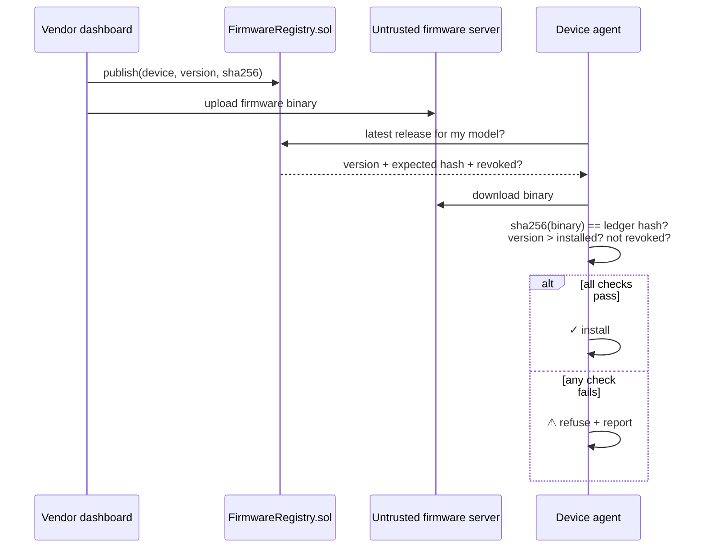

<div align="center">

# 🔐 SecureOTA

**Blockchain-anchored firmware update integrity for IoT devices —
Certificate-Transparency-style protection against tampered, rolled-back and revoked firmware.**


</div>

<!-- TODO: add a GIF of the 30-second demo below (✓ INSTALLED → tamper → ⚠ HASH_MISMATCH) -->

## The problem

IoT devices trust whatever their vendor's update server sends. Compromise the server, the CDN or
the network path, and every device installs attacker firmware. **Code signing isn't enough:** a
signature proves *who built* an image — not that it's the *current* release, or that everyone got
the *same* one.

## The idea

Publish each release's **SHA-256 fingerprint** to a public ledger — never the binary. The device
downloads from anywhere, recomputes the hash locally, and refuses to flash anything that doesn't
match the ledger, is older than what it runs, or has been revoked.



## Attacks it defeats

Every scenario runs end-to-end against a deliberately untrusted firmware server:

| Scenario | Attack | Device response |
|---|---|---|
| `01-happy-path` | — | ✓ `INSTALLED` |
| `02-tampered-binary` | Server serves a modified image | ⚠ `HASH_MISMATCH` |
| `03-rollback` | Server serves an older, vulnerable version | ⚠ `ROLLBACK_BLOCKED` |
| `04-revoked-release` | Vendor revoked a release on-chain | ⚠ `REVOKED` |

## Demo in 30 seconds (no dependencies)

```bash
cd packages/device-client && export PYTHONPATH=src
python3 -m secure_ota_device.cli.main --offline update     # ✓ INSTALLED
echo "MALICIOUS" > ../shared/fixtures/firmware/RUH-SENSOR-01-1.4.0.bin
python3 -m secure_ota_device.cli.main --offline update     # ⚠ HASH_MISMATCH
git checkout ../shared/fixtures/firmware                   # restore
```

Full four-terminal stack (local chain, contract, firmware server, E2E runner):
[`docs/RUNNING.md`](docs/RUNNING.md).

## Engineering highlights

- **Monorepo, four packages, one frozen seam** — the contract ABI and golden fixtures in
  `packages/shared` are versioned; changing them needs a `specVersion` bump.
- **Clean architecture, enforced not documented** — `test_architecture.py` parses every Python
  import and `check-layering.mjs` every TypeScript import; a layering violation fails the build.
- **Hashing happens in the browser** on the vendor dashboard — the binary never touches the chain.
- **142 automated tests** (108 device agent + 34 contract, incl. ABI conformance) plus an E2E harness.

| Package | What it is |
|---|---|
| [`device-client`](packages/device-client/) | Python verification agent (ports & adapters) |
| [`contracts`](packages/contracts/) | `FirmwareRegistry.sol` — on-chain release register |
| [`dashboard`](packages/dashboard/) | Manufacturer console: hash, publish, revoke |
| [`attack-harness`](packages/attack-harness/) | Untrusted server, 4 attack scenarios, E2E runner |

Threat model, limitations and design decisions: [`docs/PROJECT-PLAN.md`](docs/PROJECT-PLAN.md)

---

EC8204 Blockchain and Cyber Security · University of Ruhuna (2026) · team of 4.

**My role — technical lead & primary developer:** designed the architecture and the frozen
ABI/fixture seam, and built and integrated all four packages — device agent, smart contract,
manufacturer dashboard and attack harness.
**G.W. Niranga Niluminda** · [LinkedIn](https://linkedin.com/in/niranganiluminda)
